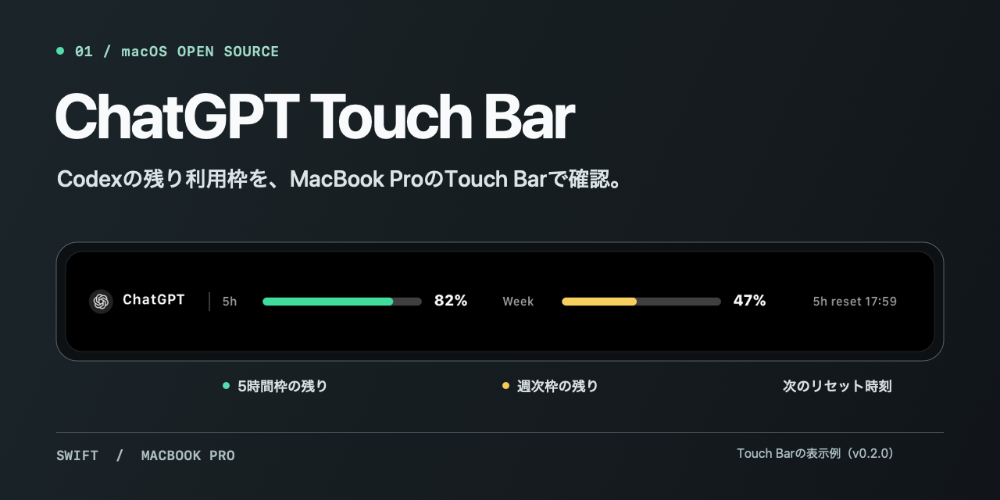
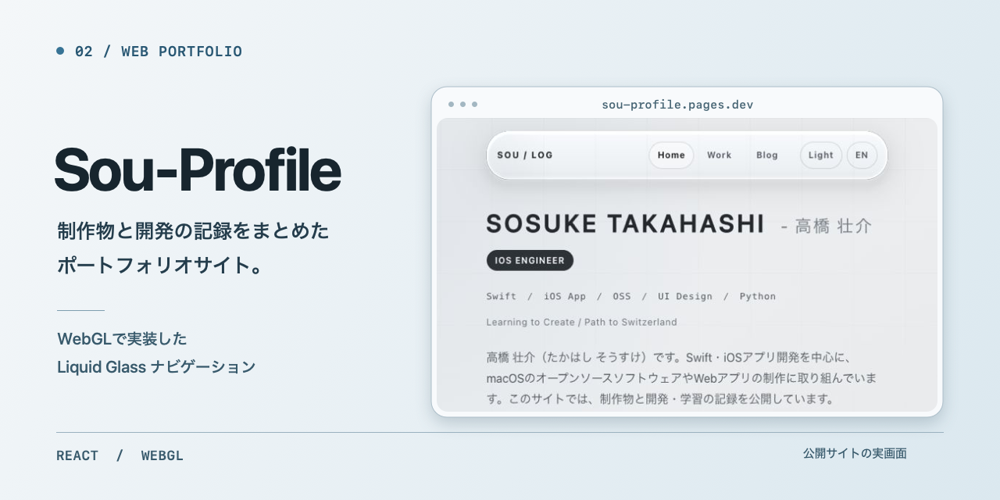
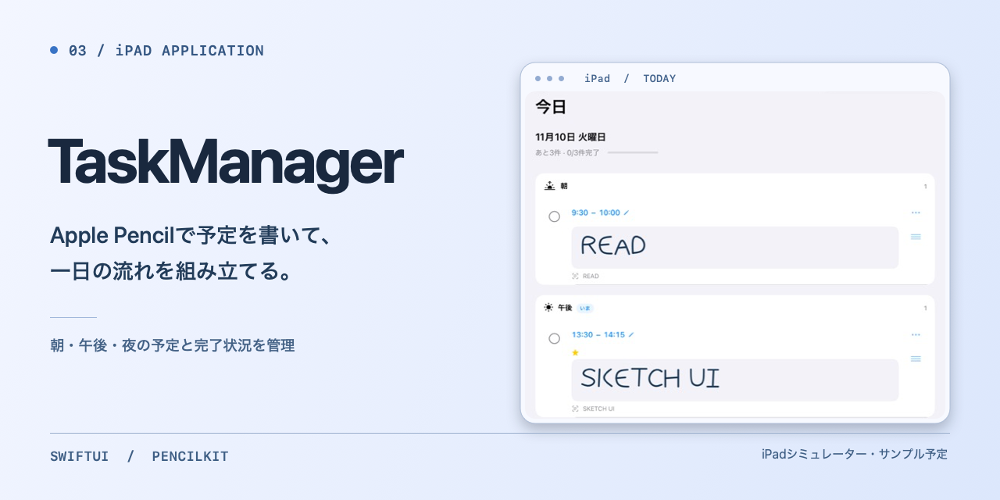
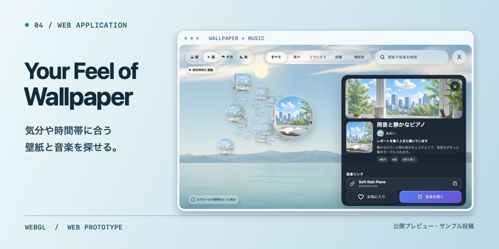
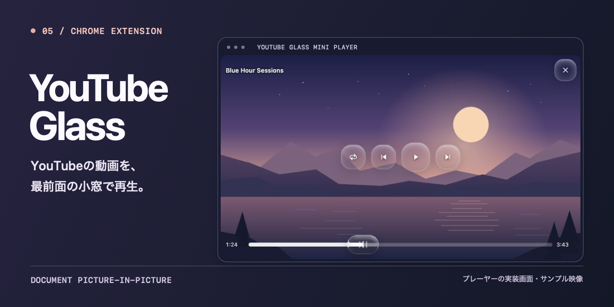

# 高橋 壮介 / Sosuke Takahashi

Swift・iOSアプリ開発を中心に、macOSのOSSやWebアプリを制作しています。開発の記録は [Sou-Profile](https://sou-profile.pages.dev/) にまとめています。

## 制作したもの

### ChatGPT Touch Bar

Codexの残り利用枠とリセット時刻をTouch Barに表示するmacOSアプリ。[ソースコード](https://github.com/sou1213/chatgpt-touchbar)

### Sou-Profile

制作物や開発の記録をまとめたReact製のポートフォリオ。[サイトを見る](https://sou-profile.pages.dev/) · [ソースコード](https://github.com/sou1213/Sou-Profile)

### TaskManager

Apple Pencilで予定を書いて、一日の流れと完了状況を管理するiPadアプリ。開発中です。

### Your Feel of Wallpaper

気分や時間帯に合う壁紙と音楽を探せるWebアプリの試作。[プレビューを開く](https://your-feel-of-wallpaper-q8m4x7.pages.dev/)

### YouTube Glass

YouTubeの動画を最前面の小窓で再生できるChrome拡張。画像はローカルでサンプル映像を使って撮影したものです。
